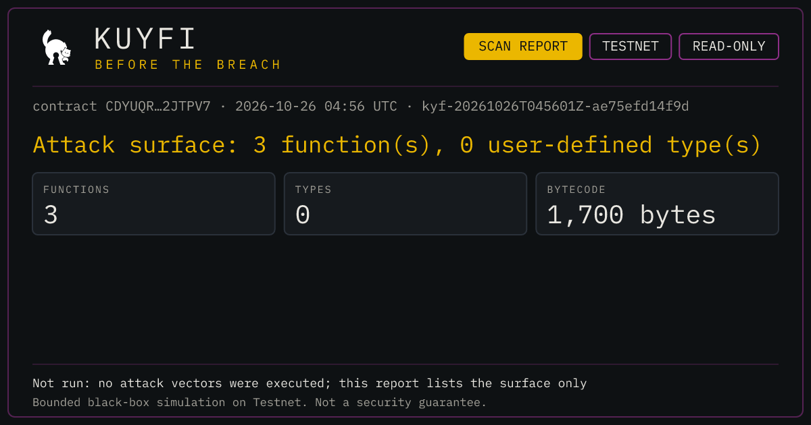
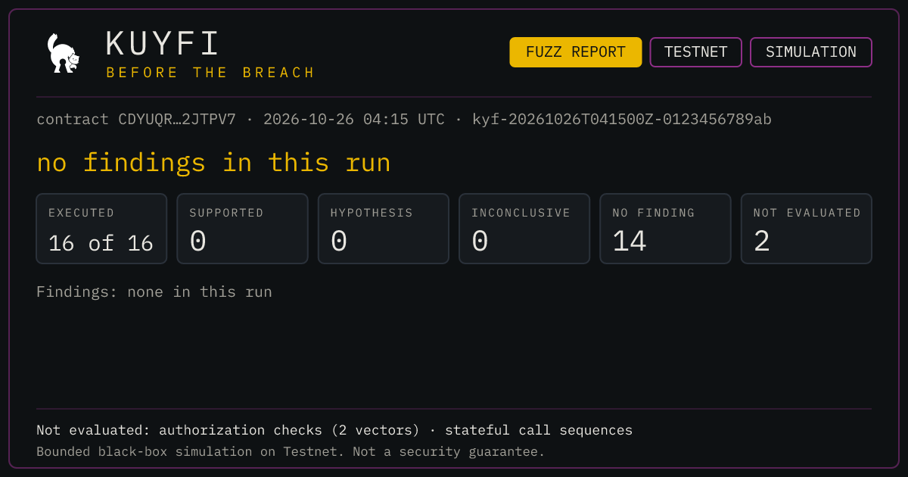
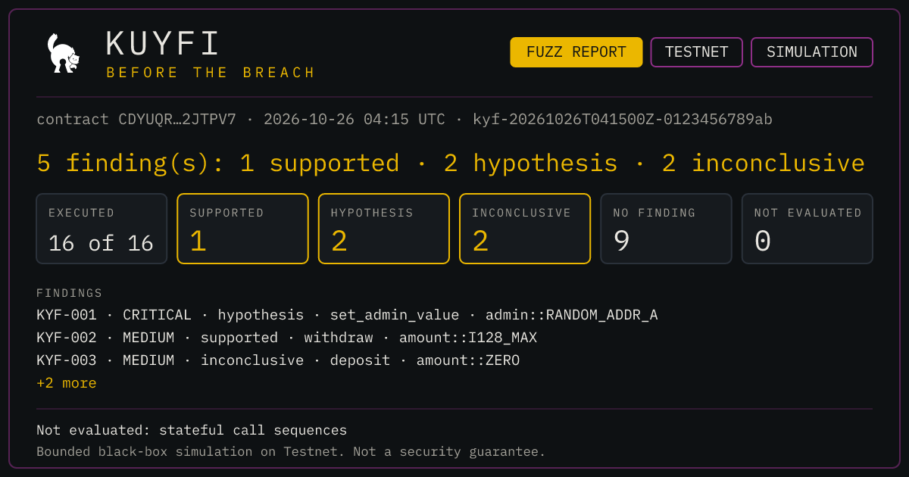

```text
      /\_/\               __ __  __  __  __  __  ____  ____               /\_/\
     ( o.o )             / // / / / / /  \ \/ / / __/ /  _/              ( o.o )
      > ^ <             / ,<   / /_/ /    \  / / _/  _/ /                 > ^ <
     /     \           /_/|_|  \____/     /_/ /_/   /___/                /     \
    (|     |)                                                           (|     |)
     \_____/                  [ CORE SECURITY MODULE ]                   \_____/
```

# Kuyfi

> Before the Breach.

[](./LICENSE)
[](./CHANGELOG.md)
[](https://developers.stellar.org/docs/networks)
[](https://docs.stellar.org/docs/smart-contracts/getting-started)

---

## What is Kuyfi?

Kuyfi is a black-box security terminal for Soroban smart contracts. It works directly against a **deployed** contract on Stellar Testnet — fetching and decoding its WASM bytecode on-chain — with no source code and no privileged access required.

## Remote MCP server (built during HackMeridian)

Kuyfi is also available as a **remote MCP server**, deployed on Cloudflare Workers. It lets you audit deployed Soroban contracts from Claude Code, Cursor or VS Code while you code — without installing the CLI or the TUI. You add one URL to your agent and sign in with GitHub the first time you connect.

- **MCP URL:** `https://kuyfi-mcp.alexbnjmnch.workers.dev/mcp`
- **Landing page (one-click install buttons):** https://kuyfi-mcp.alexbnjmnch.workers.dev/
- **Docs:** https://kuyfi-mcp.alexbnjmnch.workers.dev/docs/mcp/

### Install

| Client | How |
|---|---|
| Claude Code | `claude mcp add --transport http kuyfi https://kuyfi-mcp.alexbnjmnch.workers.dev/mcp` |
| Cursor | One click from the landing page, or add `{"mcpServers": {"kuyfi": {"url": "https://kuyfi-mcp.alexbnjmnch.workers.dev/mcp"}}}` to `~/.cursor/mcp.json` |
| VS Code | One click from the landing page, or `code --add-mcp '{"name":"kuyfi","type":"http","url":"https://kuyfi-mcp.alexbnjmnch.workers.dev/mcp"}'` |

### Tools

| Tool | What it does |
|---|---|
| `list_functions` | Lists a deployed contract's functions with their input and output types. |
| `scan_contract` | Returns the attack surface (functions and types) and saves the report for 24 hours, returning a `report_id`. |
| `fuzz_contract` | Generates attack vectors and runs them in simulation only (`mode="simulate"`, up to 50 vectors). |
| `get_report` | Retrieves a report you created earlier. Only the GitHub user who created it can read it. |
| `report_card` | Renders a PNG summary card (plus the same summary as text) for one of your reports. Same owner-only rule as `get_report`. |

### Report card

`report_card` returns a PNG summary card plus the same summary as text; the client decides whether to show the image.

<p>
  
</p>

*Real output of report_card for scan_contract on the demo contract (Testnet, 2026-10-26). Reports expire after 24 hours.*

<p>
  
  
</p>

*Illustrative samples: the first uses the figures of a real run on the demo contract but its date and report ID are placeholders; the second is a made-up sample, not a result from a real contract.*

### Example

Ask your agent:

> Audit this Testnet contract: `CDYUQRWYE6INSGTMJWHPU32VSWVOZ456EUHJMMQXTCFXPFUXPH2JTPV7`

A real run against a small demo contract, in simulation:

```
list_functions  → 3 functions: get_value, set_admin_value, secure_set_admin_value
scan_contract   → report saved (24 h)
fuzz_contract   → simulation · 16 vectors · 14 no finding · 2 not evaluated
                  no findings in this run. Not proof of security.
```

### What is new in this sprint

New in this sprint (built for HackMeridian):

- The **remote MCP server** itself: a Cloudflare Worker with GitHub login (OAuth), exposing the five tools above.
- **Simulation by default**, with per-user quotas (20 `fuzz_contract` runs per hour) and private, 24-hour reports.
- A static **landing page** with one-click install buttons, served by the same Worker.
- The **MCP section of the docs**, served at `/docs/`.

Already existed before this sprint (unchanged by it):

- The black-box OSINT scanner, the Chaos Monkey fuzzing engine and the finding taxonomy.
- The headless CLI and the interactive TUI, with JSON and PDF reports.
- The paid scan API (`kuyfi-server`, x402 on Stellar).

The MCP server reuses the scanner and the vector generation of the existing engine, ported to run inside a Worker; the CLI and TUI are documented as the local alternative and are not replaced.

### Honest limits

- **Testnet only**, and only contracts that are already deployed.
- **Simulation only:** the server never signs or sends transactions and never handles keys.
- **Authorization vectors are reported as `not evaluated`.** A simulation records authorization but does not enforce it, so an accepted call says nothing about access control.
- **No stateful call sequences:** simulations do not keep state between calls, so sequence-dependent behavior is not exercised.
- **Quotas:** up to 20 `fuzz_contract` runs per hour per user, and at most 50 vectors per run.
- **Zero findings is not proof of security.** Results are observations and hypotheses; the server does not replace a manual audit.

**Next steps:** tests with state, and wider coverage of authorization.

### Resumen (español)

Kuyfi ahora también existe como **servidor MCP remoto** (Cloudflare Workers): agregas una URL a Claude Code, Cursor o VS Code, inicias sesión con GitHub y auditas contratos Soroban ya desplegados en Testnet sin instalar el CLI ni la TUI. Tiene cinco herramientas (`list_functions`, `scan_contract`, `fuzz_contract`, `get_report`, `report_card`) y solo simula: no firma ni envía transacciones. Lo nuevo de este sprint es el servidor MCP, sus cuotas, la landing y la sección de docs; el CLI, la TUI, el escáner, Chaos Monkey y la API de pago ya existían. Cero hallazgos no es prueba de seguridad.

## Why Kuyfi exists

Formal audits (Veridise, Ottersec, CoinFabrik, and peers) require source code, scheduling, and budget. Kuyfi is meant as the layer that comes *before* that: something a developer runs against their own deployed contract to catch obvious, surface-level issues automatically — so a formal audit starts from a cleaner baseline, not so it can be skipped.

```
run Kuyfi → fix obvious issues → submit to a formal audit with a cleaner baseline
```

Kuyfi is automated black-box security testing. It is **not** a formal audit, a certification, and it does not replace either.

## What black-box auditing means

Kuyfi never sees your Rust source. Everything it knows about a contract comes from what's actually observable from the outside: the WASM bytecode a deployed contract publishes, the `contractspecv0` XDR section describing its functions and types, and how the contract actually behaves when it is called — first in simulation, then on Testnet when the call proceeds. This mirrors how an external attacker — or a black-box pentest — would approach a closed target.

## How it works

```
Contract ID
    ↓
OSINT Scanner            fetch + decode WASM, no source needed
    ↓
Attack Surface           functions, parameter types, UDTs (structs, enums, unions)
    ↓
Chaos Monkey             type-aware fuzzing: simulate first, broadcast when it proceeds
    ↓
Execution Trace Classification   DiagnosticEvent-based signal taxonomy
    ↓
SecurityReport            one shared result object
    ↓
JSON / PDF                 same data, two export formats
```

## Installation

Install globally with npm. The npm package is `@kuyfi/kuyfi`; the command it installs is `kuyfi`:

```bash
npm install -g @kuyfi/kuyfi
```

Then launch the interactive TUI:

```bash
kuyfi
```

**Requirements:** Node.js ≥ 20, npm, internet access to Stellar Testnet.

### Windows / PowerShell

Kuyfi v0.1.0 was validated manually on Windows 11 (Windows Terminal, PowerShell), installed with `npm install -g @kuyfi/kuyfi`.

Some PowerShell environments block `.ps1` wrapper scripts through the execution policy. If PowerShell reports that `kuyfi.ps1` cannot be loaded because running scripts is disabled on this system, this is PowerShell's execution-policy behavior, not a Kuyfi runtime error. The installed package is unaffected and you can call the `.cmd` wrapper directly:

```powershell
kuyfi.cmd
kuyfi.cmd --help
```

The same policy may apply to npm itself in that environment, in which case use `npm.cmd`:

```powershell
npm.cmd install -g @kuyfi/kuyfi
```

Optionally, to allow locally created scripts for your own user only, set the policy at the `CurrentUser` scope and restart PowerShell:

```powershell
Set-ExecutionPolicy -Scope CurrentUser -ExecutionPolicy RemoteSigned
```

### Run from source

To run Kuyfi from a source checkout instead:

```bash
git clone https://github.com/alex0tico/kuyfi.git
cd kuyfi
npm ci
npm run build
npm start
```

## Usage

The examples below use the `kuyfi` command. From a source checkout, use `npm start` in place of `kuyfi` for the TUI, and `node dist/cli.js` in place of `kuyfi` for the headless CLI.

**Interactive TUI:**

```bash
kuyfi
```

**Headless CLI** — same scanner and Chaos Monkey engine, no TUI, for scripting/CI use:

```bash
kuyfi <CONTRACT_ID>
kuyfi <CONTRACT_ID> --json
kuyfi <CONTRACT_ID> --pdf
kuyfi <CONTRACT_ID> --json --pdf
```

## OSINT Scanner

Given only a Contract ID, the scanner:

- fetches the contract's WASM bytecode via a read-only RPC call (`getContractWasmByContractId`) — no transactions, nothing broadcast;
- decodes the `contractspecv0` custom section directly from the WASM binary;
- builds a registry of user-defined types (structs, unions, enums) referenced by the contract;
- renders the attack surface: every function, its parameter types, and its return type.

Nothing here requires the contract's source code, an ABI file, or any cooperation from the contract's author.

## Paid scan API

`kuyfi-server` exposes the OSINT Scanner over HTTP and charges per scan with [x402](https://www.x402.org) on Stellar, priced in Chilean pesos through [Local402](https://github.com/DiegoPoveda01/local402):

```
GET /scan/<CONTRACT_ID>
  → 402 Payment Required   price in CLP, converted to USDC by the Reflector oracle
  → 200 OK                 once paid: functions, parameter types, UDTs (same shape as a SecurityReport's `scan` block)
```

Only the read-only scanner is exposed. Chaos Monkey broadcasts transactions against its target, so it stays a local, explicit action and is never offered over HTTP. A malformed Contract ID gets `400` before any price is quoted, and a scan that fails after payment (`404`, `422`, `502`) is not settled, so the payer is not charged.

```bash
cp .env.example .env              # set PAY_TO to your public G... address
npm run build
node --env-file=.env dist/server.js
```

| Variable | Default | |
|---|---|---|
| `PAY_TO` | — (required) | Public Stellar address that receives the USDC. Never a secret key. |
| `PRICE` | `500 CLP` | Any currency Reflector publishes, e.g. `0.50 USD`, `0.02 UF`. |
| `NETWORK` | `stellar:testnet` | Where the payment settles. Scans always read Testnet. |
| `FACILITATOR_URL` | public Local402 facilitator for `NETWORK` | The mainnet facilitator only settles for allowlisted `PAY_TO` addresses. |
| `PORT` | `4021` | |

Any x402 client on Stellar can pay it, for example:

```bash
npx -y local402-client quote http://localhost:4021/scan/<CONTRACT_ID>
```

## Chaos Monkey

Chaos Monkey is **not** random/dumb fuzzing. For each function the scanner discovers, it generates **type-aware** attack values from the function's actual XDR parameter types (`i128`, `u32`, `Address`, `Vec<T>`, UDTs, and more), and tests them **one variable at a time** — every other parameter holds a type-correct baseline value, so a failure can be attributed to the specific input that triggered it, not attributed to "some parameter, we're not sure which."

Generated values are type-correct, not semantically valid: a random `Address` is not a funded account, a token, or an authorized signer. Kuyfi classifies conservatively for that reason.

Five vector families:

- **Math / boundary** — per-type boundary values, for example `ZERO`, `ONE`, `NEG_ONE`, `MAX_I128`, `MIN_I128` for integers, `RANDOM_ADDR_A`/`RANDOM_ADDR_B` for addresses, and empty/oversized values for bytes, strings, symbols and vectors. UDTs are attacked recursively, one field or payload slot at a time.
- **Authorization / access control** — `UNAUTHORIZED_CALL`, `REINIT_ATTACK` and `SELF_CALL_ATTACK` against functions whose names match admin patterns (`initialize`, `set_admin`, `upgrade`, etc.), and `UNAUTHORIZED_ADDR_CALL` against non-admin functions that take an `Address`.
- **Call ordering** — the same function called twice in a row: `REINIT_SEQUENCE`, `REPEATED_WITHDRAW_SEQUENCE`, `REPEATED_CLAIM_SEQUENCE`, matched by function name.
- **Fee / basis-point** — `BPS_*` boundary values (0, 1, 9999, 10000, 10001, type max) on numeric parameters whose names look fee- or BPS-shaped.
- **Liquidity-ratio** — paired boundary combinations (`ZERO_A_MAX_B`, `MAX_A_MAX_B`, ...) on the first two numeric parameters of functions whose names suggest liquidity, swap or reserve logic.

**Execution model.** Every vector is simulated first (preflight). Only when the simulation succeeds is the transaction signed with an ephemeral, Friendbot-funded keypair, submitted to Stellar Testnet and polled for its result. Keypairs are generated in memory and never persisted to disk or logged.

```
vector → simulate (preflight)
           ├─ simulation fails    → classify from diagnostic events (nothing is sent)
           └─ simulation succeeds → sign → broadcast to Testnet → poll → classify
```

Many vectors, and many findings, are therefore classified without an on-chain transaction.

## Finding semantics

Every executed vector is classified into one of six signals, based on Soroban's `DiagnosticEvent` execution trace — not just whether the transaction succeeded or failed:

| Signal | Meaning |
|---|---|
| `SECURE` | A confident, expected outcome: the contract or host rejected the input the way you'd expect (a contract-level error, a reserved-function boundary, a host object error), or a non-access-control vector was accepted. Filtered out of the findings list; counted in the summary only. |
| `PRECONDITION_FAIL` | A confident rejection explained by missing setup — most commonly a structural auth rejection because the ephemeral test account is not an authorized signer. Filtered out of the findings list; counted in the summary only. |
| `UNEXPECTED_ERROR` | A manual-review, inconclusive signal: the vector failed but the trace does not explain why (for example a generic trap at the root of the call, or storage reached before an auth check can be confirmed). Reported as a `MEDIUM` finding, honestly labeled as inconclusive rather than forced into `SECURE` or `POTENTIAL_VULN`. |
| `POTENTIAL_VULN` | A security signal requiring contextual/manual review — not a confirmed vulnerability. Raised when an access-control vector is **not** rejected, when the trace shows a runtime-safety fault (arithmetic or index-bounds) after nested calls attributed to the target contract, or when a root-level trap follows nested calls and no fabricated `Address` argument could explain it. |
| `UNCONTROLLED_PANIC` | The target contract traps on a runtime-safety fault (arithmetic or index-bounds) with no nested-call activity — a robustness/error-handling signal, not a proven exploitable bug. Reported as a `MEDIUM` finding. |
| `TIMEOUT` | The transaction was not confirmed within the polling window. Inconclusive; reported as a `LOW` finding. |

Findings also carry a severity: `POTENTIAL_VULN` is `CRITICAL` when the function name matches an admin pattern and `HIGH` otherwise; `UNEXPECTED_ERROR` and `UNCONTROLLED_PANIC` are `MEDIUM`; `TIMEOUT` is `LOW`.

**What Kuyfi does not claim:**

- Zero findings does not prove the absence of vulnerabilities.
- A finding is a signal to investigate, not a proven exploit; `POTENTIAL_VULN` is the signal worth reviewing first, and `UNEXPECTED_ERROR` is inconclusive by design.
- Kuyfi does not replace a formal audit, and does not issue any certification.

## Execution evidence

Each `SecurityReport` includes execution evidence so its claims can be checked without trusting Kuyfi's own output:

- run-wide counters over every executed vector: vectors executed, broadcast transactions, and transactions with a hash;
- per finding: whether the simulation failed, whether a transaction was broadcast, and the parsed `DiagnosticEvent` trace that produced the classification;
- for findings whose transaction was broadcast: the `transactionHash`, the `ledger`, and a `stellar.expert` explorer URL;
- `verificationTransactions`: a small, deterministic, representative sample (the first broadcast that succeeded and the first that failed), not a complete list.

Not every vector or finding has an on-chain transaction: a vector that fails simulation is classified from its diagnostics and never sent. Only broadcast transactions can be independently verified on-chain.

## Reports

Both export formats are built from the exact same `SecurityReport` object, so a JSON and PDF export from the same run always agree on `reportId`, findings, and evidence.

- **JSON** — `schemaVersion: "1.0.0"`, machine-readable, suited for CI or further tooling.
- **PDF** — the same data laid out as a readable report, explicitly labeled as an automated black-box report, not a formal audit deliverable.

## Requirements

- Node.js ≥ 20
- Internet access to Stellar Testnet (`https://soroban-testnet.stellar.org`)

**Platform status (v0.1.0):**

- Validated manually: macOS, and Windows 11 (Windows Terminal, PowerShell — see [Windows / PowerShell](#windows--powershell)).
- Linux: expected to work with Node.js ≥ 20, but not yet manually validated in v0.1.0.

## Architecture

See [`ARCHITECTURE.md`](./ARCHITECTURE.md) for the full component breakdown — the TUI layer, the audit engine, and how they share the same code path as the headless CLI.

## Roadmap

See [`ROADMAP.md`](./ROADMAP.md).

## Contributing

See [`CONTRIBUTING.md`](./CONTRIBUTING.md) for development setup and how to open a pull request.

## Responsible Use & Limitations

Kuyfi sends **real on-chain transactions** to Stellar Testnet. Always:

- Run only against contracts you own or have explicit written authorization to test.
- Use Testnet only — never point Kuyfi at a Mainnet contract without the contract owner's consent.
- Treat every finding as a lead to investigate, not a verdict. Kuyfi does not prove a contract is secure, does not guarantee the absence of vulnerabilities, and is not a substitute for a formal audit.

Unauthorized fuzzing of third-party contracts may violate their terms of service and may be illegal in your jurisdiction.

## License

MIT — see [`LICENSE`](./LICENSE).

---

```
github.com/alex0tico/kuyfi
```

Kuyfi runs entirely on Stellar Testnet infrastructure and is built with the official `@stellar/stellar-sdk`. It is not affiliated with the Stellar Development Foundation.
